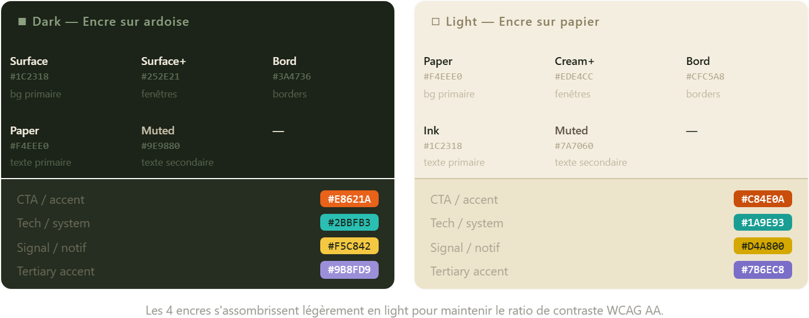
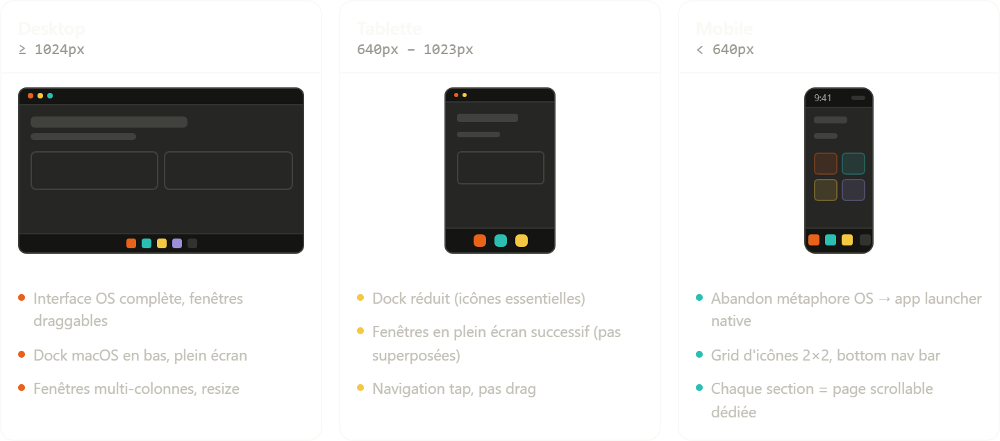
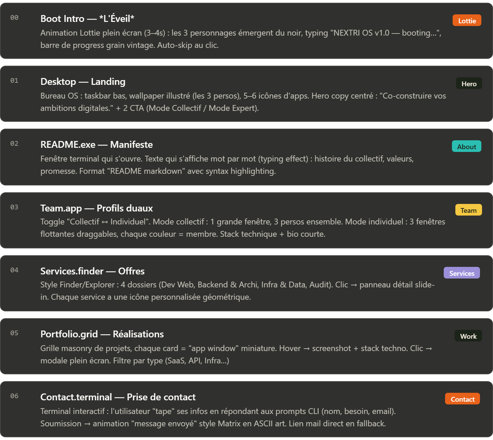

## Proposition — NEXTRI OS

---

## ① Palette — Dark & Light

Risographe en deux modes. Le grain et les encres restent identiques ; seule la base (papier vs ardoise) bascule.

---

## ② Responsive — Breakpoints

Le paradigme OS desktop ne s'adapte pas, il **se transforme** selon l'écran.**Décision clé :** Le mobile abandonne la métaphore OS — forcer un dock et des fenêtres sur 375px est une friction cognitive inutile. On conserve le *langage visuel* (couleurs, personnages, grain) mais la navigation devient native mobile.

---

## ③ Séquence d'animation — Détail technique

---

## ④ Écrans mis à jour

| # | Écran | Changements vs v1 |
|---|---|---|
| 00 | **Boot Spectacle** | Séquence A→D ci-dessus, tout CSS/JS vanilla |
| 01 | **Desktop macOS** | Dock bas avec magnification au hover, menubar haut, wallpaper avec persos |
| 02 | **À propos** — fenêtre app | Contenu textuel accessible, pas terminal/README |
| 03 | **L'équipe** — toggle Collectif/Expert | Inchangé dans le concept, retiré le terminal |
| 04 | **Services** — Finder | Inchangé |
| 05 | **Réalisations** | Inchangé |
| 06 | **Contact** — formulaire dans fenêtre | Formulaire accessible standard, exit le terminal CLI |

---